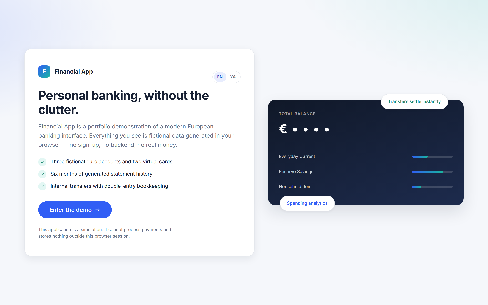
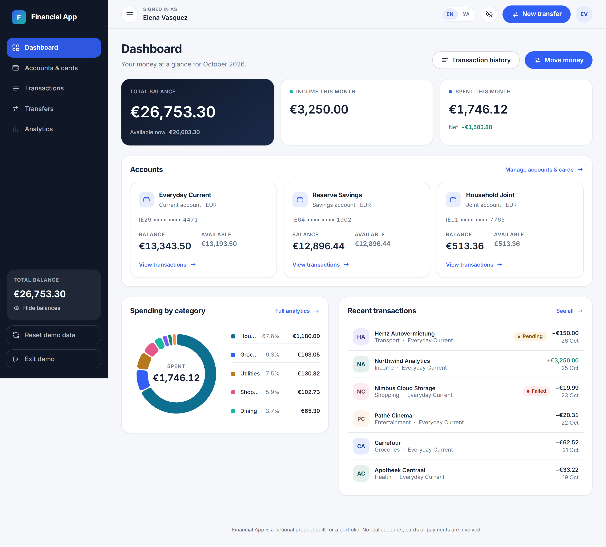
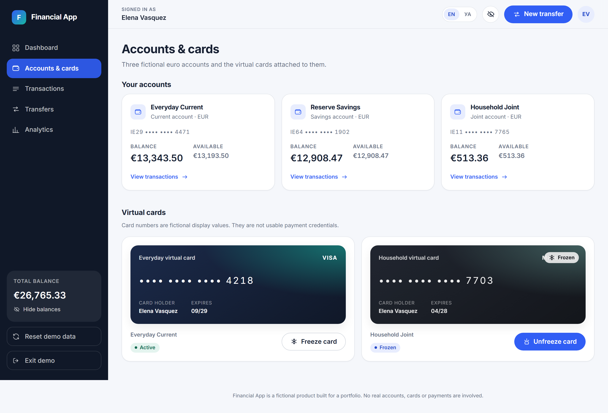
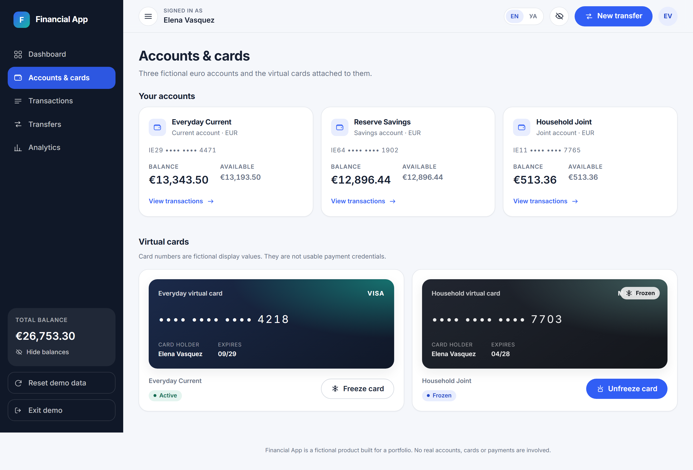
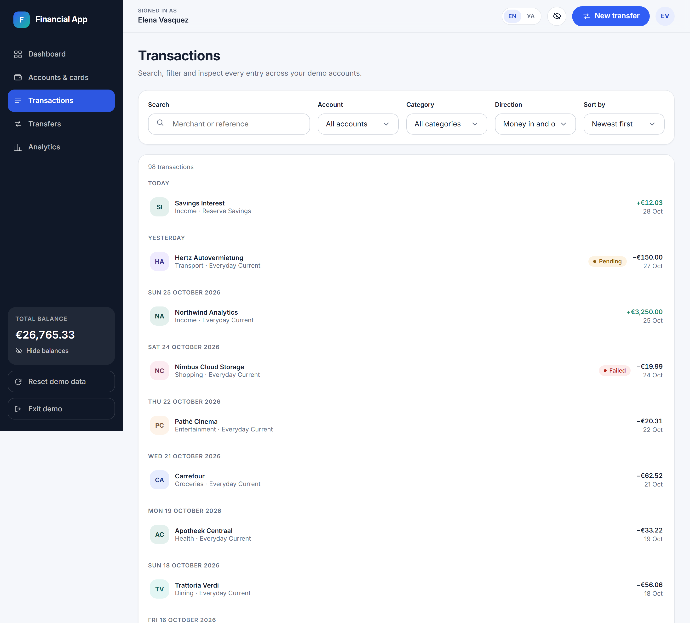
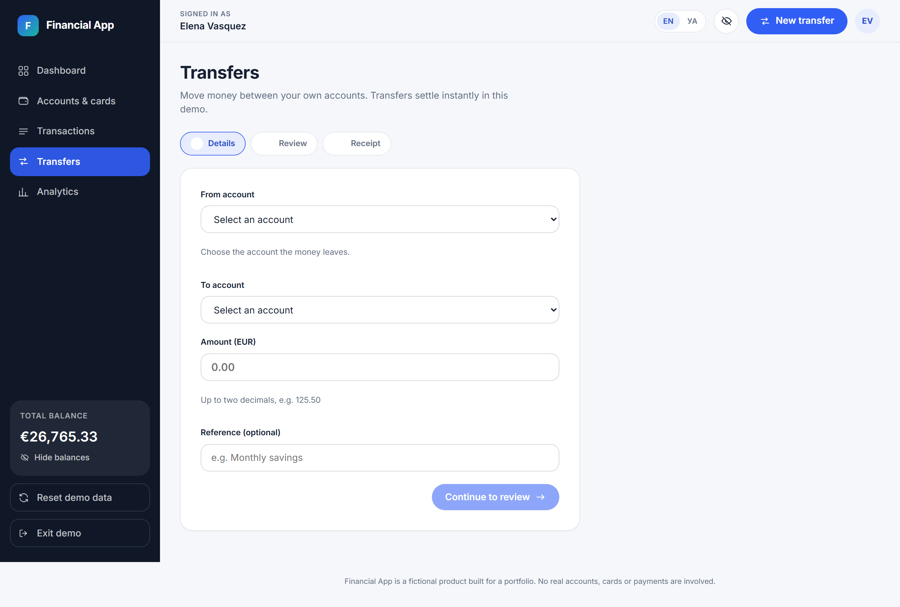
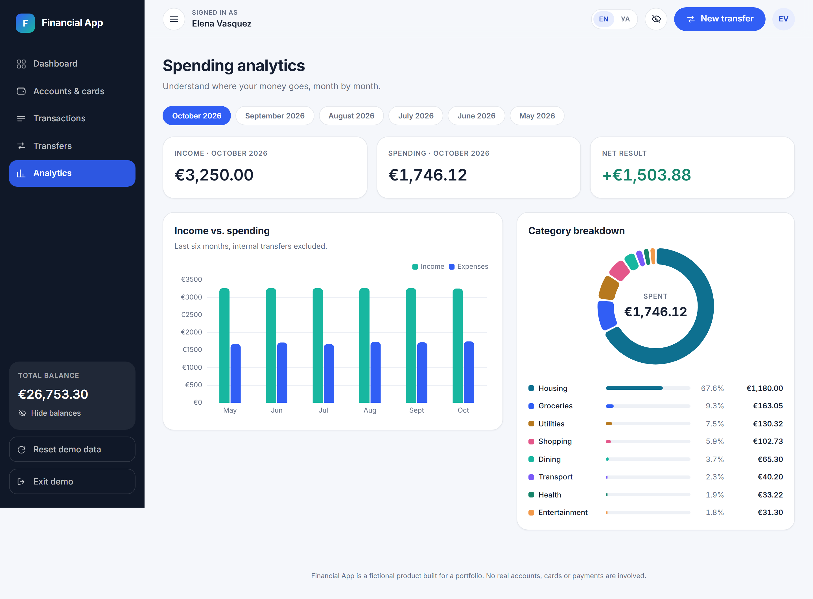
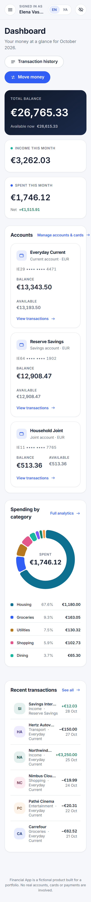
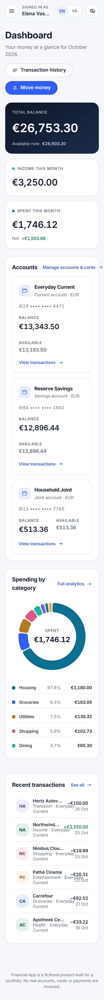

<div align="center">

# Financial App

### A fictional personal-banking SPA, implemented twice — in Angular and in React — on one shared Spring Boot API

[](https://angular.dev)
[](https://react.dev)
[](https://www.typescriptlang.org)
[](https://spring.io/projects/spring-boot)
[](https://www.postgresql.org)
[](contracts/banking-api.yaml)
[](#internationalisation)

**One product, two independent frontends, one backend.** The Angular and React applications ship the
same five feature areas, the same design language, the same business rules and the same English and
Ukrainian copy — but they share no runtime code. Each can run entirely in the browser with
deterministic demo data, or against the shared Spring Boot API.


</div>

> **This is a portfolio simulation.** Every account, card, transaction and transfer is fictional.
> The application processes no real payments, stores no real credentials, requires no login and
> makes no claim to meet banking security or regulatory requirements.

---

## Table of contents

- [Live demos](#live-demos)
- [Screens](#screens)
- [Features](#features)
- [Architecture](#architecture)
- [Operating modes](#operating-modes)
- [Local development](#local-development)
- [API examples](#api-examples)
- [Testing and quality gates](#testing-and-quality-gates)
- [Deployment](#deployment)
- [Internationalisation](#internationalisation)
- [Accessibility](#accessibility)
- [Documentation map](#documentation-map)

---

## Live demos

Both frontends build to static assets and run in **demo mode** by default, so a deployed demo needs
no backend, no database and no API key.

| Frontend | Demo | Source |
|---|---|---|
| Angular 22 | **[financial-app-demo.roman-yeremenko-o.workers.dev](https://financial-app-demo.roman-yeremenko-o.workers.dev/)** | [`app/angular-web/`](app/angular-web) |
| React 19 | **[financial-app-demo-react.roman-yeremenko-o.workers.dev](https://financial-app-demo-react.roman-yeremenko-o.workers.dev/)** | [`app/react-web/`](app/react-web) |

> Both demos run on Cloudflare Workers static assets and redeploy automatically from `main`.
> [How to deploy](#deployment).

---

## Screens

Angular on the left, React on the right. Same data, same design tokens, same layout — two separate
implementations.

| | Angular | React |
|---|---|---|
| **Welcome** |  |  |
| **Dashboard** |  |  |
| **Accounts & cards** |  |  |
| **Transactions** |  |  |
| **Transfers** |  |  |
| **Analytics** |  |  |

Mobile layout at 320 px:

<p>
  
  
</p>

---

## Features

Both frontends implement all five areas identically.

**Dashboard** — total balance across all accounts, monthly income and expenses, spending by
category, account summary cards, recent transactions, quick actions and a global balance-visibility
toggle. Every total is derived from the canonical ledger; nothing is hardcoded.

**Accounts & cards** — three fictional accounts (current, savings, joint) with masked IBANs,
currency and booked/available balances, plus two virtual cards showing a masked number, fictional
holder, expiry, network, linked account and status. Freezing or unfreezing a card requires
confirmation and reports the outcome.

**Transactions** — the full ledger with counterparty, category, date, signed amount, status and
account; free-text search, category and direction filters, date/amount sorting, day grouping, a
details dialog, a clear-filters action and meaningful empty states.

**Transfers** — between the demo persona's own accounts only. Select source and destination, enter
an amount and optional reference, validate, review, confirm explicitly, execute, and receive a
receipt. Rejected on same-account, ineligible account, non-positive amount, wrong currency
precision, currency mismatch or insufficient funds — and an invalid or cancelled transfer never
moves money. Resubmitting a reviewed transfer cannot duplicate it.

**Spending analytics** — six months of income versus expenses and a category breakdown derived from
the ledger, with internal transfers excluded so that moving your own money does not inflate either
figure.

Plus a demo-entry screen instead of authentication, runtime EN/UA switching, and a reset action that
restores the original dataset.

---

## Architecture

```text
Angular UI ──▶ Angular Signal Store ──┐
                                      ├── Demo adapter  ──▶ localStorage
                                      │
React UI ─────▶ React banking store ──┴── HTTP adapter  ──▶ Spring Boot ──▶ PostgreSQL
```

```text
pet-app/
  app/
    angular-web/     Angular 22 · Signals · NgRx Signal Store · Reactive Forms · Material
    react-web/       React 19 · Vite · React Router · React Hook Form + Zod
  services/
    banking-api/     Spring Boot 3.5 · Spring Web · JPA · Flyway · PostgreSQL 16
  contracts/
    banking-api.yaml OpenAPI 3.1 — the authoritative contract
  docs/              architecture.md · api.md · media/
  .github/workflows/ CI for all three projects
```

Each frontend is layered `features → application → domain`, with `data/` providing two
interchangeable adapters behind one `BankingDataSource` interface. Feature components never issue
HTTP calls and never branch on the operating mode. Money is always integer minor units plus an
explicit currency code — never a float — and one transfer always writes exactly two balancing ledger
entries sharing a `transferId`.

The React application is a genuinely independent implementation: it does not wrap, import from or
depend on the Angular app. The Angular app was preserved in place; only its data-access boundary was
extended to support the shared API.

Full detail, including the concurrency and idempotency design and the `app/` vs `apps/` layout
deviation, is in **[docs/architecture.md](docs/architecture.md)**.

---

## Operating modes

| | Demo mode | API mode |
|---|---|---|
| Purpose | Deployed demos, offline use | Local full-stack development |
| Data | Deterministic fictional seed, persisted in `localStorage` | PostgreSQL via the Spring Boot API |
| Backend | Not required | Required |
| Reset action | Available | Hidden |
| Default for production builds | ✅ | — |

In demo mode the same domain policy that the backend enforces runs locally, so transfers,
validation, idempotency and card status changes behave identically — the data simply lives in your
browser. A reset restores the seed, and malformed or outdated stored state is discarded safely
rather than crashing.

In API mode the backend is authoritative and re-validates everything. **There is no automatic
fallback:** if the API is unreachable, both apps show an explicit error with a retry button instead
of quietly serving demo data, because pretending a server-side transfer succeeded would be worse
than failing loudly.

---

## Local development

### Prerequisites

- **Node.js 22+** and npm 10+ (both frontends)
- **JDK 17** (backend only)
- PostgreSQL 16 is **optional** — see the zero-infrastructure option below

### Angular frontend

```bash
cd app/angular-web
npm install
npm start          # demo mode  → http://localhost:4200
npm run start:api  # API mode   → expects the backend on http://localhost:8080/api
npm run build      # demo-mode production build → dist/pet-project-angular/browser
npm run build:api  # API-mode build
```

### React frontend

```bash
cd app/react-web
npm install
npm start          # demo mode  → http://localhost:5173
npm run build      # demo-mode production build → dist/
```

For API mode, create `app/react-web/.env.local`:

```ini
VITE_DATA_MODE=api
VITE_API_BASE_URL=http://localhost:8080/api
```

Never put secrets in `VITE_*` variables — Vite inlines them into the client bundle.

### Backend

The quickest path needs **no database installation at all**. A test-scoped launcher starts the real
application against a throwaway embedded PostgreSQL 16 (unpacked to a temp directory; no Docker):

```bash
cd services/banking-api
./mvnw spring-boot:test-run      # Windows: .\mvnw.cmd spring-boot:test-run
```

With your own PostgreSQL — via `services/banking-api/docker-compose.yml` or a native install —
copy `.env.example`, fill in the connection details and run:

```bash
cd services/banking-api
./mvnw spring-boot:run
```

Either way the API serves `http://localhost:8080/api`, Flyway migrates and seeds the schema, and
Swagger UI is at <http://localhost:8080/api/swagger-ui.html>. CORS is restricted to the local
frontend dev and e2e ports. See [`services/banking-api/README.md`](services/banking-api/README.md).

---

## API examples

```bash
curl http://localhost:8080/api/health
# {"status":"UP","version":"1.0.0","profile":"local"}

curl http://localhost:8080/api/accounts
# [{"id":"acc-current","name":"Everyday Current","type":"current",
#   "maskedIban":"IE29 •••• •••• 4471",
#   "balance":{"amountMinor":1348341,"currency":"EUR"},
#   "available":{"amountMinor":1333341,"currency":"EUR"},"status":"active"}, ...]

curl "http://localhost:8080/api/transactions?direction=debit&category=groceries&sort=amount-desc&size=2"
# {"items":[...],"page":0,"size":2,"totalItems":18,"totalPages":9}

curl -X POST http://localhost:8080/api/transfers \
  -H "Content-Type: application/json" \
  -H "Idempotency-Key: 6f1c2b84-5f0d-4a4b-9f1a-5a1d2c3e4f50" \
  -d '{"sourceAccountId":"acc-current","destinationAccountId":"acc-savings",
       "amount":{"amountMinor":25000,"currency":"EUR"},"reference":"Monthly saving"}'
# 201 Created, Idempotency-Replayed: false
# {"id":"transfer-732dd6f1-...","status":"completed",
#  "debitTransactionId":"txn-8fcea47b-...","creditTransactionId":"txn-50624be2-..."}
```

Replaying that key with the same payload returns `200 OK` and `Idempotency-Replayed: true` without
creating a second pair of ledger entries. Replaying it with a different payload is rejected:

```bash
# 409 {"code":"IDEMPOTENCY_KEY_REUSED","message":"This idempotency key was already used
#      with a different transfer.","timestamp":"..."}

# 422 {"code":"SAME_ACCOUNT","message":"The source and destination accounts must be different."}
# 422 {"code":"INSUFFICIENT_FUNDS","message":"Not enough available funds in the source account."}
# 422 {"code":"CURRENCY_MISMATCH","message":"The transfer currency must match both accounts."}
# 404 {"code":"CARD_NOT_FOUND","message":"The requested card could not be found."}
```

Every endpoint, query parameter, schema and error code is documented in
**[docs/api.md](docs/api.md)** and defined in
**[contracts/banking-api.yaml](contracts/banking-api.yaml)**.

---

## Testing and quality gates

| | Angular | React | Backend |
|---|---|---|---|
| Lint | `npm run lint` | `npm run lint` · `npm run lint:styles` | — |
| Types | `npm run typecheck` | `npm run typecheck` | — |
| Format | `npm run format:check` | `npm run format:check` | — |
| Unit / component | `npm test` — 96 | `npm test` — 118 | `./mvnw verify` — 47 |
| End-to-end | `npm run e2e` — Playwright 7 + Cypress 6 | `npm run e2e` — Playwright 7 | — |

Install browsers once per frontend with `npm run e2e:install`.

`lint:styles` is React-specific: React has no style encapsulation, so a class name declared in two
feature stylesheets silently overrides across the whole app depending on bundle order.
`app/react-web/tools/class-collisions.mjs` fails if any class is declared in more than one SCSS
file.

[`.github/workflows/ci.yml`](.github/workflows/ci.yml) runs all three projects in parallel on every
push and pull request.

---

## Deployment

Both frontends are static bundles, so any static host works. They are deployed to **Cloudflare
Workers** static assets, one Worker per frontend, redeploying automatically on every push to `main`.
Demo mode is the default production configuration, so no environment variables are required.

| | Angular | React |
|---|---|---|
| Live demo | [financial-app-demo](https://financial-app-demo.roman-yeremenko-o.workers.dev/) | [financial-app-demo-react](https://financial-app-demo-react.roman-yeremenko-o.workers.dev/) |
| Base directory | `app/angular-web` | `app/react-web` |
| Build command | `npm ci && npm run build` | `npm ci && npm run build` |
| Publish directory | `dist/pet-project-angular/browser` | `dist` |
| Worker config | [`app/angular-web/wrangler.jsonc`](app/angular-web/wrangler.jsonc) | [`app/react-web/wrangler.jsonc`](app/react-web/wrangler.jsonc) |

The SPA history fallback comes from `not_found_handling: "single-page-application"` in each
`wrangler.jsonc`. Neither project ships a `_redirects` file: on Workers static assets a
Pages-style `/* /index.html 200` rule collides with the built-in HTML handling and the deploy is
rejected with `Invalid _redirects configuration: Infinite loop detected in this rule`. A `postbuild`
hook (`tools/strip-cf-asset-config.mjs`) deletes `_redirects` and `_headers` from the build output
so a stale build directory cannot reintroduce one. On hosts other than Workers — Netlify, Vercel,
Nginx — configure the equivalent rewrite to `index.html` instead.

The backend is a local development and portfolio component. It runs on any machine with a JDK and is
not required for the deployed demos; no paid infrastructure is needed anywhere in this project.

---

## Internationalisation

English (`en`) and Ukrainian (`ua`), switchable at runtime from the app shell and the welcome screen
with no page reload. The choice is persisted in `localStorage` and the `<html lang>` attribute stays
in sync. Dates and money are formatted with `Intl` using `en-IE` and `uk-UA`, and both dictionaries
are typed and share one key tree, asserted by tests. Angular uses its existing signal-based
translation service with a translated route-title strategy; React uses `react-i18next`.

> The application's own code for Ukrainian is `ua`. The registered ISO-639-1 subtag is `uk`, and
> that is what browsers, screen readers and `Intl` understand, so `LANGUAGE_HTML_TAG` and
> `LANGUAGE_LOCALE` map `ua` to `uk` and `uk-UA` respectively instead of reusing the app code.

---

## Accessibility

Targeting WCAG AA: semantic landmarks, a skip link, labelled controls, visible keyboard focus,
dialog focus management and restoration, reduced-motion support, and real loading, empty, error,
disabled and success states. Layouts are verified from 320 px to 1920 px with no horizontal
overflow, and automated axe-core audits report **zero violations on every route in both
frontends**.

---

## Documentation map

| Document | Contents |
|---|---|
| [docs/architecture.md](docs/architecture.md) | Layering, adapters, money model, double-entry, idempotency, layout deviations |
| [docs/api.md](docs/api.md) | Endpoint reference, query parameters, error codes, idempotency semantics |
| [contracts/banking-api.yaml](contracts/banking-api.yaml) | OpenAPI 3.1 contract — the source of truth |
| [services/banking-api/README.md](services/banking-api/README.md) | Backend setup, migrations, seeding, locking, testing |
| [app/angular-web/README.md](app/angular-web/README.md) | Angular implementation guide |

---

<div align="center">

Fictional data only · No real payments · No authentication · Built as a portfolio project

</div>
