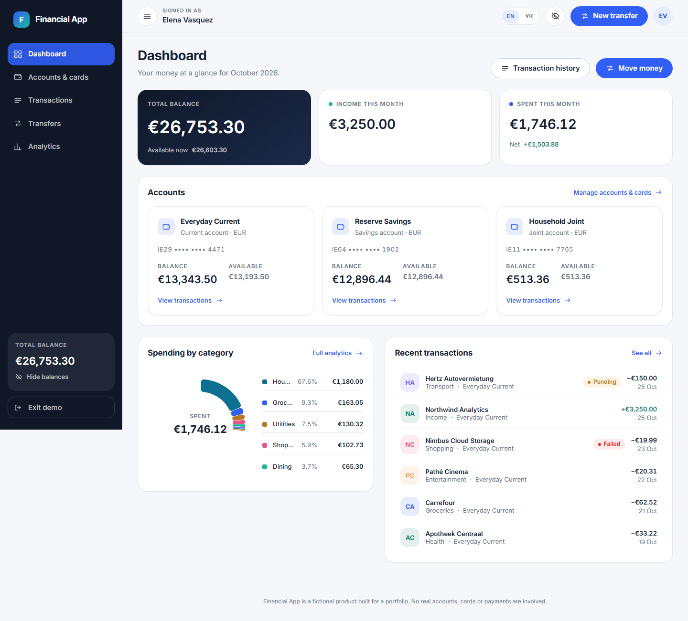
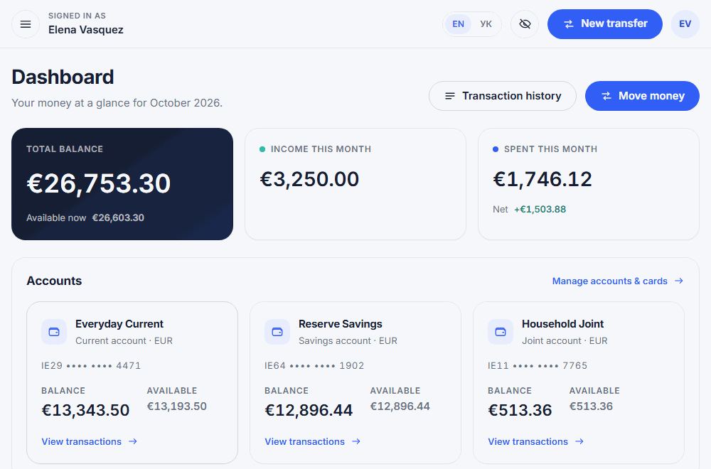
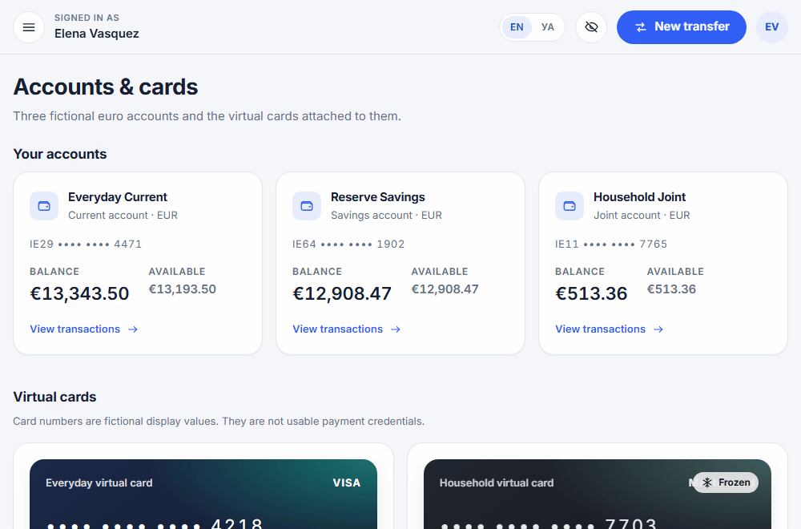
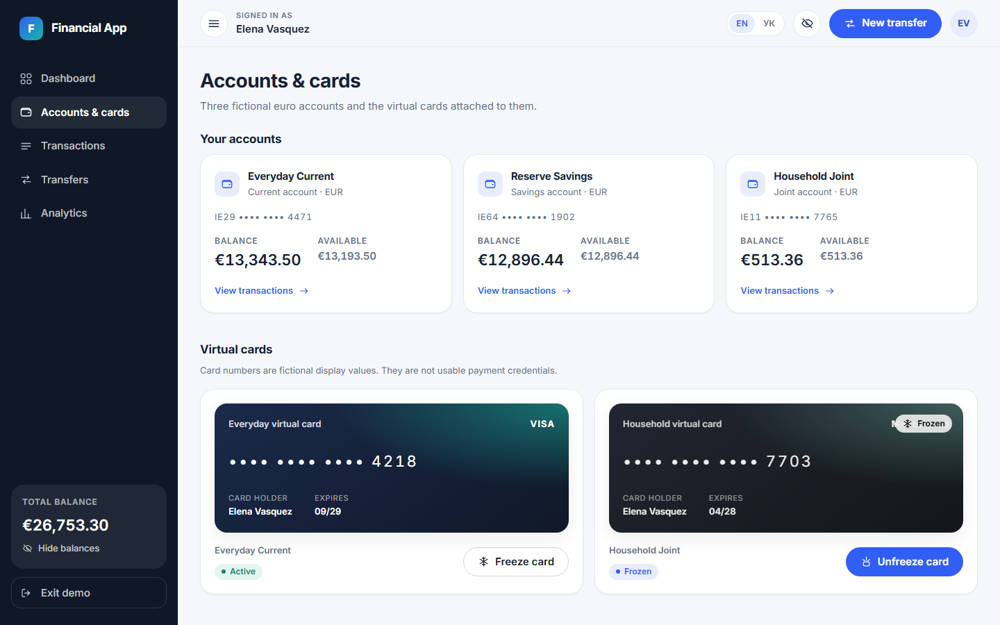
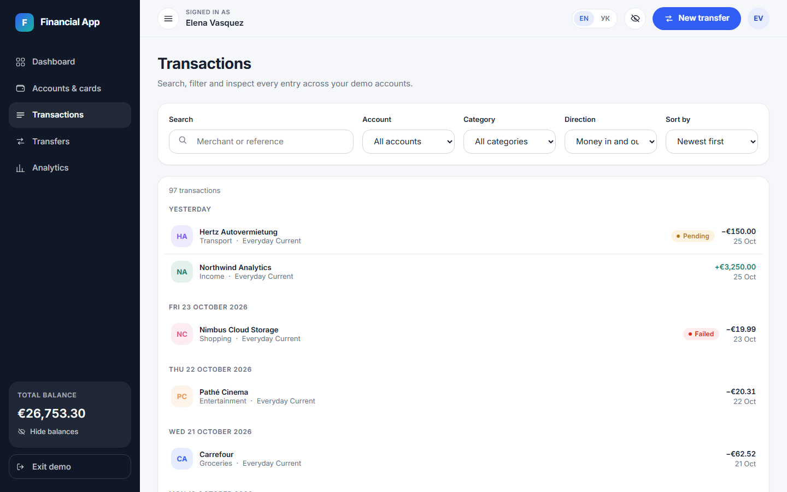
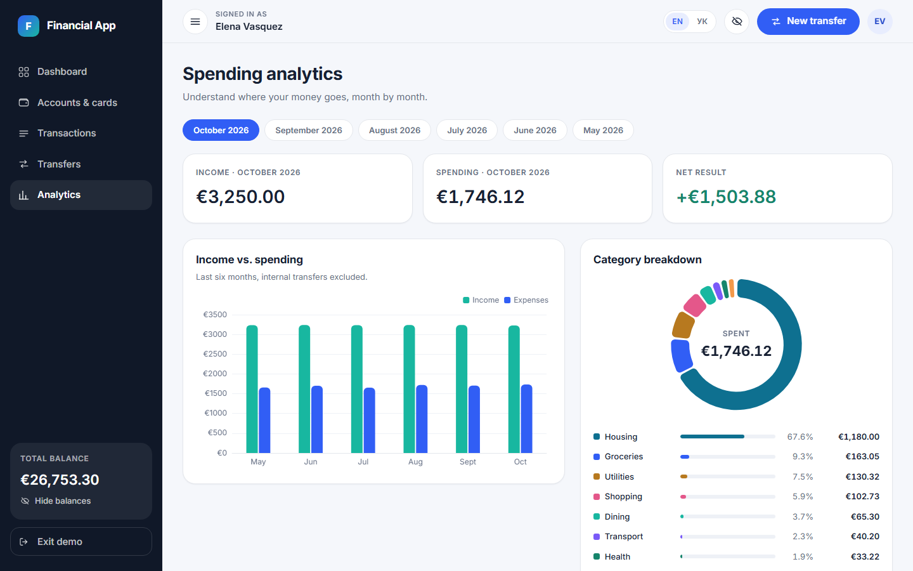
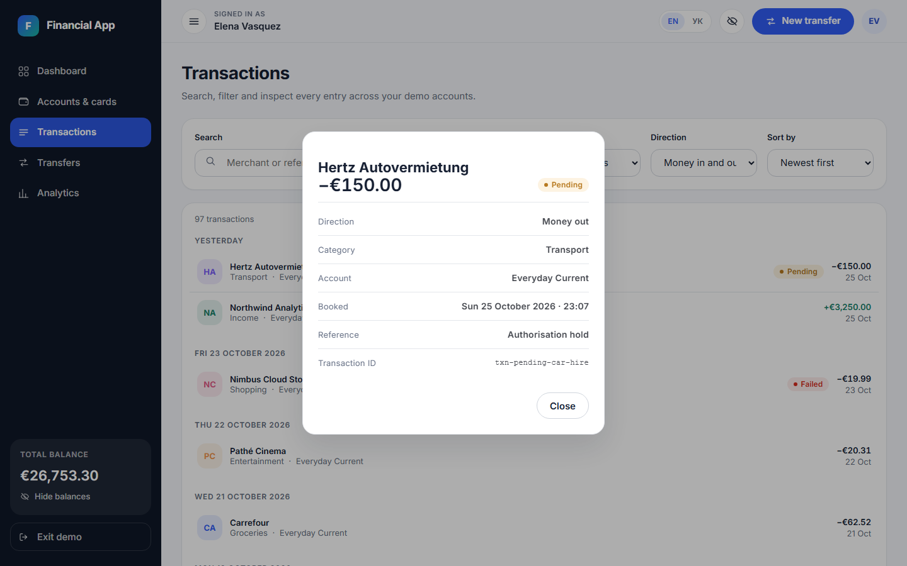
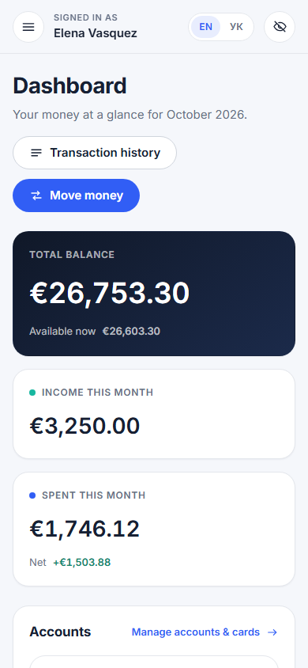
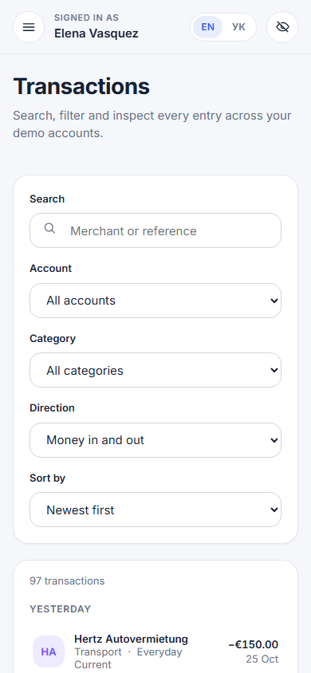

<div align="center">

# Financial App

### A premium personal-banking SPA built with Angular 22, Signals and a strict, test-first architecture

[](https://angular.dev)
[](https://www.typescriptlang.org)
[](https://ngrx.io/guide/signals)
[](https://material.angular.dev)
[](https://playwright.dev)
[](https://cypress.io)
[](#internationalisation)

A simulation of a modern European digital bank. No authentication and no payment rails: every
account, card and transaction is fictional. It runs **standalone in demo mode** with no backend at
all, and can also connect to the shared [Spring Boot API](../../services/banking-api) in API mode —
see [operating modes](../../README.md#operating-modes).



</div>

---

## Table of contents

- [Highlights](#highlights)
- [Screens](#screens)
- [Getting started](#getting-started)
- [Architecture](#architecture)
- [Money and internal transfers](#money)
- [State](#state)
- [Testing](#testing)
- [Internationalisation](#internationalisation)
- [Accessibility and responsiveness](#accessibility-and-responsiveness)
- [Deployment](#deployment)

## Highlights

| Area                   | What it does                                                                                          |
| ---------------------- | ----------------------------------------------------------------------------------------------------- |
| **Demo entry**         | A one-click gate instead of authentication; guards the product routes and survives a reload.          |
| **Dashboard**          | Total balance, monthly income/expenses, spending-by-category donut, account cards, recent activity.   |
| **Accounts & cards**   | Three fictional EUR accounts and two virtual cards with freeze/unfreeze behind a confirmation dialog. |
| **Transactions**       | Search, account/category/direction filters, four sort orders, day grouping and a details dialog.      |
| **Transfers**          | Internal transfers with a details -> review -> confirm -> receipt flow and idempotent execution.      |
| **Spending analytics** | Six-month income/expense bars and a category breakdown derived from the same ledger.                  |
| **Languages**          | Full English and Ukrainian interface, switchable at runtime and remembered between visits.            |

Balances can be hidden globally from the top bar, and every figure in the app is derived from one
dataset, so no two screens can disagree.

### The internal transfer flow

Source and destination accounts, an amount validated against the domain rules, an explicit review
step and a receipt that links straight into the ledger it just created.



### Runtime language switching

English and Ukrainian are both complete. Switching re-renders labels, dates and currency formatting,
and the choice survives a reload.



## Screens

| Accounts & cards                                                                                    | Transactions                                                                                                  |
| --------------------------------------------------------------------------------------------------- | ------------------------------------------------------------------------------------------------------------- |
|  |  |

| Spending analytics                                                                                                     | Transaction details                                                                           |
| ---------------------------------------------------------------------------------------------------------------------- | --------------------------------------------------------------------------------------------- |
|  |  |

<div align="center">
  
  
  <p><em>The same product from 320&nbsp;px to 1920&nbsp;px.</em></p>
</div>

> Every image above was captured from the running application, not mocked up.

## Getting started

### Requirements

- **Node.js 20.19+ / 22.12+** (Angular 22 requirement)
- npm 10+

### Run it

```bash
npm install
npm start             # http://localhost:4200
```

Click **Enter demo** on the welcome screen — there is nothing to sign up for.

To run against the shared backend instead of browser-local demo data, start the
[Banking API](../../services/banking-api) and then:

```bash
npm run start:api     # http://localhost:4200, reading and writing through the API
```

`angular.json` swaps `src/environments/environment.ts` for `environment.api.ts` in the `api`
configuration; no component changes are involved. If the API is unreachable the app says so and
offers a retry — it never falls back to demo data silently.

### Commands

| Command               | Purpose                                                                  |
| --------------------- | ------------------------------------------------------------------------ |
| `npm start`           | Dev server on port 4200                                                  |
| `npm run start:api`   | Dev server in **API mode**, against `http://localhost:8080/api`          |
| `npm run build`       | Production build into `dist/pet-project-angular/browser`                 |
| `npm run build:api`   | Production build in API mode                                             |
| `npm test`            | Unit tests (Vitest + Spectator), single run                              |
| `npm run test:watch`  | Unit tests in watch mode                                                 |
| `npm run e2e`         | **Both** end-to-end suites: Playwright, then Cypress                     |
| `npm run e2e:pw`      | Playwright suite only                                                    |
| `npm run e2e:cy`      | Cypress suite only (headless)                                            |
| `npm run e2e:cy:open` | Cypress interactive runner                                               |
| `npm run e2e:install` | One-off Playwright browser download                                      |
| `npm run lint`        | ESLint over TypeScript **and** templates                                 |
| `npm run typecheck`   | `tsc --noEmit` over app, unit specs, Playwright **and** Cypress projects |
| `npm run format`      | Prettier write (`format:check` to verify)                                |

Every end-to-end command boots its own dev server on port **4280** via `start-server-and-test` and
shuts it down afterwards, so there is no manual setup step.

## Architecture

### Technology

- **Angular 22** — standalone components, **zoneless** change detection, lazy routes, `inject()`.
- **Signals** for state and `computed()` for every derived figure. RxJS covers the async edges
  (`toSignal`, repository latency, transfer settlement) — there are no promises in application code.
- **NgRx Signal Store** (`@ngrx/signals`) as the single source of truth.
- **Reactive Forms** for the filter bar and the transfer wizard.
- **Angular Material 22** for dialogs and snack bars only; everything else is custom SCSS.
- **ECharts** via `ngx-echarts`, lazily loaded.
- **SCSS design tokens** in `src/styles/_tokens.scss`.
- **Vitest** (through `@angular/build:unit-test`) with **Spectator**, plus **Playwright** and
  **Cypress** for end-to-end journeys.

### Layout

```
src/app/
  core/          layout shell, demo session + guard, feedback, i18n, ECharts registration
  domain/        models, money arithmetic, transfer policy, analytics  (pure, framework-free)
  data/          deterministic mock dataset + repository (async seam)
  application/   BankingStore (NgRx Signal Store) + transfer use case
  features/      dashboard, accounts, cards, transactions, transfers, analytics, demo entry
  shared/
    ui/          domain-agnostic primitives (icon, money, skeleton, status-chip,
                 empty-state, page-header, confirm-dialog, language-switcher)
    charts/      ECharts wrappers (spending-donut, monthly-bars)
    ledger/      presentational components that know the domain models
                 (account-card, transaction-row)
    util/        small pure helpers, one concern per `*.util.ts` file
                 (date, category, monogram, id, collection, translation-key)
```

Two deliberate deviations from a textbook layout:

- **`domain/` is split by concern** (`money/`, `models/`, `transfers/`, `analytics/`) so the pure
  financial rules are importable and testable without any Angular dependency.
- **`data/` and `application/` are separate from `core/`.** `core/` holds app-wide plumbing, while
  `application/` holds the store and use cases and `data/` holds the mock access layer. Keeping them
  apart makes the dependency direction obvious: `features -> application -> domain`, with `data`
  injected at the edge.

`shared/` is grouped by **how coupled a component is to the domain**, not by an undifferentiated
`components/` bucket: `ui/` knows nothing about banking and could ship in any app, `charts/` owns the
ECharts dependency, and `ledger/` is allowed to take `Account` / `Transaction` as inputs. Each
component lives in its own folder next to its stylesheet.

### Code conventions

- Every function is an **arrow function**; the `function` keyword is not used anywhere.
- Component and service files contain **nothing but the class** — helpers, validators and lookup
  tables live in sibling `*.util.ts` / `*.storage.ts` modules (for example
  `features/transfers/transfer-form.util.ts`, `features/accounts/card-actions.util.ts`).
- Asynchrony is expressed with **Observables**; there are no `async` functions or promises in `src/`.
- **No magic numbers or strings in logic.** Every meaningful literal is a named constant
  (`SETTLEMENT_LATENCY_MS`, `FILTER_DEBOUNCE_MS`, `REFERENCE_MAX_LENGTH`, `MS_PER_DAY`,
  `MONTH_KEY_LENGTH`, …), and shared values live in one place: `core/charts/chart-theme.ts` for
  chart colours and geometry, `domain/money/` for currency precision and the privacy mask.
- **Styles always live in an external `.scss` file next to the component.** No inline `styles`
  arrays, and no `style` attributes in templates — both are enforced by lint.
- **No `!important` and no `::ng-deep`.** Angular Material is restyled through its own design
  tokens (`--mat-dialog-headline-padding`, `--mat-dialog-container-shape`,
  `--mat-menu-container-shape`, …). Tokens are either declared on `:host` — custom properties
  inherit into the Material markup the component projects — or redeclared on the very element that
  consumes them, so the override wins on cascade order instead of on brute specificity. Reduced
  motion works the same way: `_tokens.scss` collapses `--fin-duration-*` under
  `prefers-reduced-motion`, so no global `!important` reset is needed.

### Lint rules worth knowing

`eslint.config.js` goes well beyond the Angular CLI default and encodes the conventions above so
they cannot silently regress:

- **Architecture:** `component-max-inline-declarations` (`styles: 0`),
  `consistent-component-styles`, `prefer-on-push-component-change-detection`, `prefer-standalone`,
  `prefer-inject`, `use-injectable-provided-in`, `use-component-view-encapsulation`,
  `no-forward-ref`, `inject-at-top`, `sort-lifecycle-methods`.
- **Type-aware signal safety:** `no-uncalled-signals`, `reactive-context-must-read-signal`,
  `no-floating-promises`, `no-misused-promises`, `prefer-readonly`,
  `switch-exhaustiveness-check`, `no-unnecessary-condition`.
- **Project conventions:** `func-style` plus a `no-restricted-syntax` list banning
  `FunctionDeclaration`, `async` functions, `await` and `new Promise`; `no-restricted-imports`
  banning `BehaviorSubject`; `@typescript-eslint/no-magic-numbers`.
- **Templates:** `prefer-control-flow`, `prefer-self-closing-tags`, `no-inline-styles`,
  `no-duplicate-attributes`, `button-has-type`, `eqeqeq`, `no-any`, `no-positive-tabindex`,
  `prefer-template-literal`.
- **General quality:** `complexity` capped at 12 (which is why `validateTransfer` is composed from
  small rule helpers), `curly`, `no-param-reassign`, `no-nested-ternary`, `no-else-return`,
  `prefer-template`, `object-shorthand`, `arrow-body-style`.

## Money

All amounts are **integer minor units** plus an explicit currency code (`{ amountMinor, currency }`).
There is no floating-point arithmetic anywhere in the financial path; strings are parsed to minor
units once (`parseAmountToMinor`) and formatted once (`formatMoney`, tabular numerals). Adding or
comparing two different currencies throws `CurrencyMismatchError` rather than silently coercing.

### Internal transfers

A transfer is **double entry**: one `Transfer` record produces exactly two `Transaction`s that share
a `transferId` — a `debit` on the source and a `credit` on the destination. `amountMinor` is always
positive and the sign is carried by `direction`, so the ledger always nets to zero.

`validateTransfer` and `applyTransfer` (`domain/transfers/transfer-policy.ts`) are pure functions.
`applyTransfer` returns a brand-new snapshot or nothing at all, which makes "an invalid transfer
never changes balances" true by construction. Enforced rules:

- source and destination must both exist, be active and be different;
- the amount must be present, a whole number of minor units and positive;
- both accounts and the draft must share one currency;
- the source must have sufficient **available** funds (balance minus pending holds).

`TransferService` owns orchestration only. `execute()` returns a cold `Observable<TransferResult>`:
nothing settles until a caller subscribes, and `shareReplay` means concurrent subscribers for one
request token share a single settlement. A request token is minted when the user reaches the review
step; completed and in-flight submissions are keyed by that token, so a double click or a resubmitted
review cannot produce a second transfer.

## State

`BankingStore` is an **NgRx Signal Store** (`@ngrx/signals`) and the single source of truth:
`withState` holds the canonical entities (accounts, cards, transactions, transfers, load status),
and everything else — totals, monthly figures, category breakdown, recent activity, the ledger
snapshot handed to the domain layer — is a `withComputed` projection, so no displayed amount can
drift from the dataset. Writes go through `patchState` and are immutable; loading is an
`rxMethod` that keeps the Observable pipeline (dedupe -> `switchMap` -> `catchError`) out of the
components and tears itself down with the store. No `BehaviorSubject` state store, no duplicated
derived values.

Store helpers that are not part of the store definition itself (initial state, the "load is
redundant" predicate, the immutable card updates) live in `banking.store.util.ts`.

## Testing

```bash
npm test          # 83 unit tests
npm run e2e       # 6 Playwright journeys + the same 6 in Cypress
```

### Unit tests — Vitest + Spectator

Unit tests cover money arithmetic and currency precision, analytics/dashboard totals, transaction
filtering and sorting, transfer validation, successful transfers, insufficient funds, repeated
submissions, ledger/balance consistency, card freeze-unfreeze, reactive form validation, and the
i18n layer (language switching, persistence, dictionary key parity).

Angular-dependent suites (store, transfer use case, transfer wizard, language service) use
**Spectator** (`@ngneat/spectator/vitest`) for their test beds. Pure domain modules have no Angular
dependency, so their specs stay plain Vitest with no test bed at all.

### End-to-end — two runners, one contract

The same six journeys are implemented twice: once with **Playwright** and once with **Cypress**.
Both suites drive the real application against the same `data-qa` hooks, so a regression is caught
regardless of which runner you prefer — and the accessors demonstrate how the same page-object
contract maps onto two very different APIs.

```
e2e/
  qa.ts                          QA_ATTRIBUTE + qaSelector, shared by both runners
  playwright/
    accessors/
      qa.ts                      getByTestId wrapper
      app.accessor.ts            demo gate, navigation, language switch, confirm dialog
      accounts.accessor.ts       account summaries, card tiles, freeze toggle
      transactions.accessor.ts   filter bar, result list, details overlay
      transfers.accessor.ts      wizard form, review step, receipt
    fixtures.ts                  injects the accessors as Playwright fixtures
    financial-app.pw.spec.ts     user journeys only
  cypress/
    support/e2e.ts               `cy.qa()`, `cy.qaIn()`, `shouldHaveTrimmedText()`
    accessors/                   the same four accessors, chainable style
    specs/financial-app.cy.ts    the same six journeys
```

Both specs are tagged in their top-level `describe` — `Financial App demo [playwright]` and
`Financial App demo [cypress]` — so a failure in a shared report is attributable at a glance.

| Journey                                             | Playwright | Cypress |
| --------------------------------------------------- | :--------: | :-----: |
| Demo entry unlocks the dashboard and guards routes  |     ✅     |   ✅    |
| Transactions can be filtered, cleared and inspected |     ✅     |   ✅    |
| A valid transfer completes and updates the ledger   |     ✅     |   ✅    |
| An invalid transfer is blocked before money moves   |     ✅     |   ✅    |
| A card can be frozen and unfrozen with confirmation |     ✅     |   ✅    |
| The interface switches to Ukrainian and back        |     ✅     |   ✅    |

Playwright specs destructure the accessors they need (`async ({ app, transfers }) => …`) thanks to
`fixtures.ts`; Cypress instantiates them once per spec. Either way the spec reads as a description of
user intent and never builds a selector itself.

`tsconfig.e2e.json` and `tsconfig.cypress.json` type-check the two suites — both runners only
transpile TypeScript, so without those projects the accessors would have no compile-time safety net.

### Selectors: `data-qa` only

Every DOM lookup — in unit specs and in both e2e suites — resolves through a `data-qa` attribute.
Classes, tag names, ARIA roles and visible text are never used as selectors: classes belong to
styling, and text changes with the interface language, so both make tests fail for reasons that have
nothing to do with behaviour.

`e2e/qa.ts` owns the one constant both runners share:

```ts
export const QA_ATTRIBUTE = 'data-qa';
export const qaSelector = (id: string): string => `[${QA_ATTRIBUTE}="${id}"]`;
```

`playwright.config.ts` points `testIdAttribute` at it, and the Cypress support file builds
`cy.qa()` / `cy.qaIn()` from the same selector. Composite widgets expose a hook per meaningful part
(`card-tile` -> `card-toggle`, `card-status`, `card-frozen-badge`) so an accessor can scope a query
to one instance, and overlay components carry theirs on the host
(`host: { 'data-qa': 'confirm-dialog' }`).

## Internationalisation

English (`en`) and Ukrainian (`ua`) are both complete. The language switcher sits in the top bar and
on the demo gate; the choice is written to `localStorage` under `financial-app.language` and
restored on the next visit, and `<html lang>` is kept in sync via `LANGUAGE_HTML_TAG`, which maps
the application's `ua` code onto the registered ISO-639-1 subtag `uk` that browsers and screen
readers expect.

`@ngx-translate/core` was chosen over `@angular/localize` because the latter compiles one bundle per
locale and cannot switch language at runtime without a page load.

Dictionaries are **TypeScript modules, not JSON assets** (`src/app/core/i18n/translations/`). The
English file is the contract:

```ts
export type TranslationDictionary = typeof EN_TRANSLATIONS;
export const UK_TRANSLATIONS: Translated<TranslationDictionary> = { … };
```

A missing or misspelled Ukrainian key is a compile error rather than a blank label at runtime, and a
spec additionally asserts key parity and matching `{{ interpolation }}` placeholders.
`StaticTranslateLoader` serves the dictionaries from the bundle, so switching is synchronous and
there is no HTTP round trip.

The `domain/` layer stays language-free: it emits enum values and error **codes**.
`shared/util/translation-key.util.ts` maps those to translation keys, and the template applies
`| translate`. That keeps business rules testable without a translation service and means a new
language never touches the domain.

Dates and amounts are formatted with `Intl` against `LanguageService.locale()` (`en-IE` / `uk-UA`),
which is read inside the relevant `computed()`s so every figure re-renders on a language switch.

To add a language: extend `APP_LANGUAGES`, `LANGUAGE_LOCALE`, `LANGUAGE_HTML_TAG` and
`LANGUAGE_SHORT_LABEL` in `core/i18n/language.ts`, add a dictionary typed as
`Translated<TranslationDictionary>`, and register it in `static-translate.loader.ts`.

## Accessibility and responsiveness

Semantic landmarks and a skip link, labelled form controls, visible focus rings, `aria-live` result
counts, keyboard-operable dialogs, AA-contrast colours and a `prefers-reduced-motion` opt-out.
Layouts are fluid from 320 px to 1920 px with a drawer navigation on small screens.

## Deployment

The app is a static bundle with hash-free routing, so any static host works:

```bash
npm run build          # outputs dist/pet-project-angular/browser
```

Serve that folder with a **SPA fallback** that rewrites unknown paths to `index.html` — Netlify
`/* /index.html 200`, Vercel rewrites, or Nginx `try_files $uri /index.html`. For a quick local
check: `npx serve -s dist/pet-project-angular/browser`.

## Licence

Portfolio/demo project. Fictional data only. Card numbers, IBANs, merchants and balances are
invented and are not usable payment credentials.
